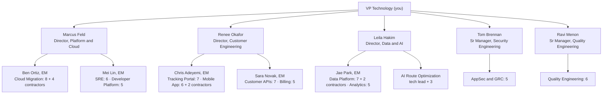

# Tallmast Logistics: Company Context (fictional)

> The single source of truth for every BMAD session, all seed data and every demo in the series. Copy this file to `docs/company-context.md` in the product repo.
>
> **Fictional company.** Every name, number and event here is invented for the series. Any resemblance to a real company or person is coincidental. Never mix in real employer data.

## Company

- Regional freight and last-mile delivery company · ~2,000 employees · ~$800M revenue
- Fiscal year = calendar year. The series opens on **Monday of Week 1, Q4**.
- Business pressures: peak season (Nov–Dec) carries ~35% of annual volume; enterprise shippers now require SOC 2 Type II; revenue missed plan in Q3.

## Executive team

| Role | Name | What they care about |
|---|---|---|
| CEO | Elena Marsh | Growth and board expectations; wants a clear answer and a date |
| CFO | Grace Whitfield | Cash, commitments, timing; hates surprises more than bad news |
| COO | Omar Reyes | Peak season, SLAs, customer escalations |
| CPO (owns the 3 product managers) | Hannah Cole | Customer roadmap, competitive features |
| Chief Risk & Compliance Officer | Arjun Mehta | SOC 2, regulatory exposure, red lines |
| VP People | Nina Laurent | Attrition, workload, manager capacity |
| **VP Technology (the executive seat)** | **You** | Everything below |

## Technology organization: ~90 people (82 employees + 8 contractors)



Twelve teams with 71 engineers, plus 5 engineering managers, 3 directors, 2 senior managers and you. The 3 product managers sit in Hannah Cole's product org with a dotted line to the directors.

### Team signals (team-level only; 8-week trend)

| Team | EM | People | Deploys / week | Change failure rate (8 wks ago → now) | Planned capacity | Notes |
|---|---|---|---|---|---|---|
| Cloud Migration | Ben Ortiz | 8 + 4c | 6 | 12% → 14% | 105% | 14 of 40 services migrated (plan: 22) |
| SRE | Mei Lin | 6 | — | — | 100% | The only team with data-center network knowledge |
| Developer Platform | Mei Lin | 5 | 10 | 5% → 5% | 90% | Has slack; could lend people |
| Tracking Portal | Chris Adeyemi | 7 | 8 | 8% → 13% | 104% | p95 latency +60% at peak hours; no load test since spring |
| Mobile App | Chris Adeyemi | 6 + 2c | 3 | 6% → 6% | 95% | Healthy |
| **Customer APIs** | Sara Novak | 7 | 5 | **9% → 21%** | **118% for 6 sprints** | Reported **green**. 3 Sev-2 incidents in 14 days; on-call pages 2.3× Q2; unplanned work 45% of each sprint |
| Billing & Invoicing | Sara Novak | 5 | 2 | 4% → 4% | 100% | Runs the legacy on-prem billing system |
| Data Platform | Jae Park | 7 + 2c | 4 | 10% → 11% | 102% | Phase 1 ran over its estimate |
| Analytics & BI | Jae Park | 5 | 3 | 3% → 3% | 85% | Has slack |
| AI Route Optimization | tech lead → Leila | 4 | 1 | — | 80% | No production pilot yet; bus factor 1 on the model pipeline |
| AppSec & GRC | Tom Brennan | 5 | — | — | 110% | SOC 2 evidence collection |
| Quality Engineering | Ravi Menon | 6 | — | — | 100% | Escaped defects up 35% in 8 weeks, visible only in a weekly report nobody reads |

### The five leaders: management patterns

These five drive the Manager Playbook Shorts and give the AI board realistic people dynamics.

| Leader | Pattern | What it looks like | How a good VP coaches it |
|---|---|---|---|
| Marcus Feld, Platform & Cloud | **The Optimist** | Says yes, gives dates instead of ranges, reports amber late | Ask "what has to be true for that date?"; require ranges and leading indicators; review the plan B, not the date |
| Renee Okafor, Customer Engineering | **The Firefighter** | Heroic incident response; team at 118% load; prevention work never gets scheduled | Protect capacity; reward prevention; rotate on-call; fix the system, not the fire |
| Leila Hakim, Data & AI | **The Visionary** | Compelling ideas, thin delivery evidence; an AI pilot with no kill criteria | Stage-gate the funding; agree kill criteria and ROI checkpoints up front |
| Tom Brennan, Security | **The Alarm** | Escalates everything, so people tune him out. This week he's right | A shared severity framework; "bring options, not just alarms"; back him quickly and publicly when it's real |
| Ravi Menon, Quality | **The Quiet Signal** | Sees problems in the data first but doesn't escalate | Create a safe channel; give him the stage at the ops review; credit early bad news |

## Strategic initiatives

| Initiative | Priority | Owner | Budget | Spent (Jan–Sep) | Reported | What's actually happening |
|---|---|---|---|---|---|---|
| Cloud Modernization: exit the data center | Critical | Marcus | $5.2M | $3.9M | Amber | 3 weeks behind; 14 of 40 services migrated vs. 22 planned. A $0.94M migration-partner change order is waiting for signature (+18%) |
| Customer Platform Reliability | Critical | Renee | $3.1M | $2.3M | **Green** | See Customer APIs and Tracking Portal above |
| Security & Compliance: SOC 2 Type II | Critical | Tom | $1.6M | $1.0M | Green | On track for the Jan 31 audit window, until Monday |
| Data Modernization (phase 1 of 2) | High | Leila | $2.4M | $1.9M | Amber | Phase 1 ran 9% over and borrowed phase 2's money; phase 2 hasn't started |
| AI Route Optimization (pilot) | High | Leila | $1.3M | $0.9M | **Green** | No production pilot after 2 quarters; ROI hypothesis untested |
| Run the business (KTLO, support, licenses, shared platform) | — | Various | $6.4M | $2.8M | — | Includes the legacy billing system; most license renewals land in Q4 |
| **Total** | | | **$20.0M** | **$12.8M** | | |

Season 1 uses only these summary fields. Season 2's Finance module replaces them with the detail below.

## Budget (FY, in $K)

| Line | Plan | Actual Jan–Sep | Open commitments | Uncommitted |
|---|---:|---:|---:|---:|
| **CapEx:** capitalized engineering labor | 4,800 | 3,600 | 0 | 1,200 |
| CapEx: infrastructure & hardware (Q4 deliveries) | 2,000 | 1,000 | 1,000 | 0 |
| CapEx: capitalizable software | 700 | 400 | 300 | 0 |
| CapEx: contingency | 500 | 100 | 300 | 100 |
| **CapEx total** | **8,000** | **5,100** | **1,600** | **1,300** |
| **OpEx:** workforce (non-capitalized) | 6,400 | 4,800 | 0 | 1,600 |
| OpEx: contractors | 800 | 600 | 200 | 0 |
| OpEx: cloud | 2,200 | 1,770 | 0 | 430 |
| OpEx: SaaS & support licenses (renewals signed) | 1,300 | 300 | 1,000 | 0 |
| OpEx: vendors & managed services (incl. 2 observability vendors) | 900 | 150 | 600 | 150 |
| OpEx: training & travel | 400 | 80 | 0 | 320 |
| **OpEx total** | **12,000** | **7,700** | **1,800** | **2,500** |
| **Total** | **20,000** | **12,800** | **3,400** | **3,800** |

**Facts the finance episodes depend on** (the engine must reproduce them exactly):
- Remaining budget: $7.2M = $3.4M committed + $3.8M uncommitted.
- **Uncommitted is not discretionary.** $2.8M of the $3.8M is Q4 payroll ($1.2M capitalized + $1.6M OpEx), and $0.43M is cloud you'll consume anyway. Truly discretionary money is about **$0.57M** (vendors $150K + training $320K + contingency $100K).
- Cloud ran on plan in Q1 and Q2 ($550K each), then **22% over in Q3** ($670K) as dual running started. If Q4 repeats Q3, year-end cloud is $2.44M, $240K over plan.
- Three forecasts:
  - Run-rate: $12.8M ÷ 0.75 ≈ **$17.1M** (looks comfortable).
  - Commitment-aware: $12.8M actual + $3.4M committed + $2.8M Q4 payroll + $0.67M Q4 cloud + $0.57M remaining discretionary ≈ **$20.24M**.
  - If the change order is signed: ≈ **$21.18M** (+5.9%).
- Capitalization follows Tallmast's finance policy as approved by the controller. The platform never assumes a cost is CapEx.

## Decision debt (decisions that keep getting postponed)

| Decision | Postponed | Cost of delay | Owner | Blocked by |
|---|---|---|---|---|
| Retire the legacy on-prem billing system | 3 quarters | ~$45K/month (support contract + data-center footprint) | Renee | Customer APIs capacity |
| SRE staffing: hire 2 FTEs or use a managed service | 2 months | ~$30K/month of contractor overtime, plus on-call burnout | Marcus | Budget approval |
| AI Route Optimization: continue, pivot or stop | 2 quarterly reviews | ~$108K/month burn (pausing frees people, not dollars, unless they're reassigned) | Leila | No agreed success criteria |
| Consolidate the two observability vendors | 1 quarter | ~$15K/month of forgone savings ($180K/yr) | Mei Lin | Migration timing |
| Data-center lease: renew Jan–Jun of next year ($540K) or commit to a cutover date | Due Dec 1 | $540K, landing in next year's budget | Marcus / CFO | Migration slip |
| Migration-partner change order ($940K) | Awaiting signature | Signing adds $940K to this year's forecast | Marcus | Migration slip |

## Calendar

- **Week 1, Q4:** the crisis week (below)
- **Mid-November:** board of directors meeting; the CEO presents technology status
- **Nov 15 – Jan 5:** peak-season change freeze (emergency fixes only)
- **Dec 1:** data-center lease decision deadline
- **Jan 31:** the SOC 2 Type II audit window closes

## Pending CEO requests (S2E4: The Cost of Saying Yes)

| Request | Sponsor | Rough size | Cost | Teams needed |
|---|---|---|---|---|
| Customer self-service returns portal | COO | ~16 team-weeks | ~$0.4M | Tracking Portal, Customer APIs |
| AI-powered delivery ETA predictions | CEO | ~20 team-weeks | ~$0.6M + cloud | Data & AI, Customer APIs |
| EU data residency for a new enterprise customer | CPO | ~12 team-weeks | ~$0.3M | Platform, Security |

Customer APIs appears in two of the three requests and is already at 118%.

## Starter rules (deterministic and explainable)

| Rule | Condition | Result |
|---|---|---|
| Silent failure risk | Reported green AND any of: ≥2 Sev-2+ incidents in 14 days; change failure rate up ≥50% over 8 weeks; planned capacity >110% for ≥3 sprints | Flag on the Command Center with the rule, the data and the owner |
| Key-person risk | A critical system has ≤1 engineer with working knowledge (bus factor ≤1) | Red; needs a named mitigation owner |
| Decision debt | Postponed ≥2 reviews, OR cost of delay ≥$25K/month, OR deadline within 90 days | Goes to the VP's decision queue |
| Overcommitment | A team is on >2 critical initiatives, OR planned capacity >100% for ≥2 sprints | Amber; show the competing commitments |
| Budget variance | Forecast over approved by ≥5% (initiative) or ≥2% (total) | Alert, with the driver |

All thresholds are versioned configuration, shown on every alert. Sanity check: with this data, Customer Platform trips the silent-failure rule, Customer APIs trips key-person risk once Alex and Priya leave, and the observability decision does *not* reach the VP queue. That last one is a deliberate negative test.

## The Q4 crisis week (S1E8; replayed with full financial detail in S2E5)

Monday of Week 1, Q4:

| Time | Event | Owner |
|---|---|---|
| 08:10 | Critical vulnerability (CVSS 9.8) in an internet-facing dependency of the Customer APIs. Public exploit code exists; no sign of exploitation yet. The fix needs the Customer APIs team. | Tom |
| 09:30 | The third Sev-2 in 14 days: tracking-portal timeouts. A top-5 customer threatens SLA penalties. Peak season starts in 6 weeks. | Renee |
| 11:00 | Alex and Priya, two senior Customer APIs engineers, resign for a competitor. Their last day is in 3 weeks. They are 2 of the 3 engineers who know the legacy billing integration. | Sara / Renee |
| 14:00 | The cloud migration is 3 weeks behind. Cutover would land inside the change freeze. The lease decision ($540K) is due Dec 1, and the $940K change order is waiting. | Marcus |
| 16:30 | The CFO announces a 15% cut to the annual technology budget because of the revenue miss, effective now, with a plan due Friday. She doesn't say whether she means 15% of this year's budget or a 15% lower run-rate. | Grace |

**Why it's hard (the interlocks)**
- **One team, three fires.** Customer APIs is on the critical path for the vulnerability and the incidents, and it's about to lose two seniors.
- **Time collides with money.** Cutting over during the freeze risks peak season; renewing the lease costs $540K next year, which is exactly where a run-rate cut lands.
- **15% isn't 15%.** $3.0M is 41.7% of the $7.2M remaining and 78.9% of the $3.8M uncommitted, and only about $0.57M is truly discretionary.
- **Decision debt comes due.** The billing retirement and the AI pilot decision were postponed because of the same capacity constraint.

**What the platform must produce:** a 24-hour action plan, a 30-day recovery plan, an owner (role) for every action, measures of success, a CEO brief, the decisions that need executive approval, and review dates.

**Scenario text to paste into an AI Board session**

```text
Week 1 of Q4 at Tallmast Logistics. Five things happened today:
1. A critical vulnerability (CVSS 9.8) in an internet-facing Customer APIs dependency. Public exploit code, no exploitation seen yet. The fix needs the Customer APIs team.
2. The third Sev-2 in 14 days on the tracking portal. A top-5 customer threatens SLA penalties. Peak season starts in 6 weeks.
3. Two senior Customer APIs engineers resigned. Their last day is in 3 weeks. They are 2 of the 3 people who know the legacy billing integration.
4. The cloud migration is 3 weeks behind. Cutover would land in the Nov 15 – Jan 5 change freeze. The data-center lease decision ($540K) is due Dec 1, and a $940K partner change order is waiting for signature.
5. The CFO cut the annual technology budget by 15%, effective now. The plan is due Friday.

Use the platform's data for capacity, commitments, budget and decision debt. Each advisor answers independently first.
Produce three strategies with their business, financial, delivery, people and security consequences. Challenge unsupported assumptions and say what information is missing. Recommend one strategy.
Then draft the 24-hour plan, the 30-day plan, owners, success measures, a CEO brief and the list of decisions that need my approval.
Recommend only. I decide.
```

## Seed-data principles

- Team-level metrics only: DORA (deploy frequency, lead time, change failure rate, time to restore), incidents, capacity, on-call load, unplanned work. Never individual productivity scores.
- 26 weeks of history for every team, with the trends above built in.
- Generate everything from a fixed seed, so demos, tests and recordings always match.
- After S1E8, write a "30 days later" section here based on the decision you actually made, including at least one thing that went wrong. S2E6 grades your decisions against it.
